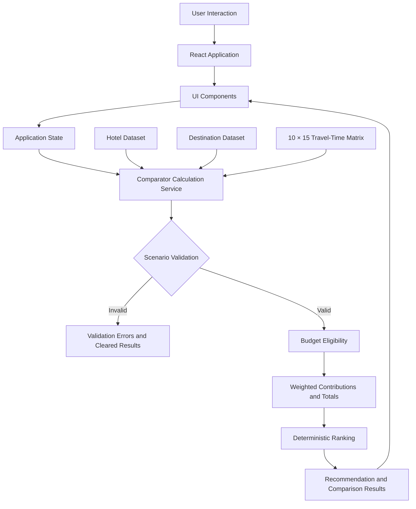

<div align="center">

# BaseCamp 

### A budget-aware decision aid for choosing the best hotel base-camp for a group city trip

**Project ID:** `SPR26_D2_P03`  
**Category:** AI-Assisted Coding Interview Solution

[](https://react.dev/)
[](https://developer.mozilla.org/en-US/docs/Web/JavaScript)
[](https://vite.dev/)
[](https://tailwindcss.com/)
[](https://pnpm.io/)

**Choose the most accessible hotel within budget—not simply the cheapest one.**

</div>

---

## Table of Contents

- [Project Overview](#project-overview)
- [Quick Start](#quick-start)
- [Problem Statement](#problem-statement)
- [City Scenario: Aethelgard Bay](#city-scenario-aethelgard-bay)
- [Key Features](#key-features)
- [How the Recommendation Algorithm Works](#how-the-recommendation-algorithm-works)
- [Baseline Scenario and Results](#baseline-scenario-and-results)
- [Acceptance Criteria Compliance](#acceptance-criteria-compliance)
- [System Architecture](#system-architecture)
- [Architecture Images](#architecture-images)
- [Technology Stack](#technology-stack)
- [Project Structure](#project-structure)
- [Automated Test Suite](#automated-test-suite)
- [Engineering Decisions](#engineering-decisions)
- [Limitations and Future Improvements](#limitations-and-future-improvements)
- [Author](#author)

## Project Overview

**Hotel Base-Camp Comparator** is an interactive decision-aid application that helps travel groups select an optimal lodging base-camp for a city trip.

The application compares each hotel's complete-stay price with its known round-trip travel times to the group's agreed wishlist destinations. Users can adjust the available budget and the importance assigned to each destination. The application then identifies affordable hotels and ranks them by weighted travel accessibility.

The central idea is that **the cheapest hotel is not necessarily the best base-camp**. A slightly more expensive hotel may provide substantially better access to the places the group cares about, while still remaining within budget.

The prototype uses a fictional coastal city called **Aethelgard Bay** and a deterministic local dataset. All hotel, destination, and travel-time data are bundled with the frontend; the supplied implementation does not require a backend or external travel API.

## Quick Start

### Prerequisites

- [Node.js](https://nodejs.org/)
- [pnpm](https://pnpm.io/)

### Run locally

```bash
# 1. Install dependencies
pnpm install

# 2. Run the automated acceptance test suite
pnpm test

# 3. Start the interactive development server
pnpm dev
```

Open the local URL printed by Vite in the terminal.

### Other available commands

```bash
# Create a production build
pnpm build

# Run ESLint
pnpm lint

# Preview the production build locally
pnpm preview
```

## Problem Statement

When planning a group trip, choosing accommodation based only on price can lead to inefficient travel. A low-cost hotel may be far from several high-priority attractions or food destinations. A centrally located hotel may reduce travel time but exceed the group's budget.

The application models this decision using four factors:

1. **Complete-stay cost:** the total hotel cost for the stay.
2. **Wishlist destinations:** the places the group has agreed to visit.
3. **Destination importance:** a priority value assigned to each place.
4. **Round-trip travel time:** the known travel time between a hotel and a destination.

The comparator first enforces the budget constraint, then ranks the hotels that satisfy it. This ensures that an unaffordable hotel cannot become the recommendation merely because it has an excellent location.

## City Scenario: Aethelgard Bay

Aethelgard Bay is a fictional coastal city represented by a fixed scenario dataset.

| Scenario element | Specification |
|---|---|
| Hotel base-camps | Exactly 10 |
| Wishlist destinations | Exactly 15 |
| Attractions | 8 |
| Food destinations | 7 |
| Destination importance | Whole-number values from 1 to 5 |
| Default total importance | 43 |
| Default priority tiers | 4 distinct tiers in the supplied scenario |
| Travel-time matrix | 10 × 15, containing 150 pairwise values |
| Round-trip travel-time range | 10–98 minutes |
| Hotel complete-stay cost range | $820–$2,200 |

### Hotel base-camps

The 10 hotel records use stable IDs from `H01_PALACE` through `H10_STRAND`.

### Wishlist destinations

The 15 destinations are divided into two categories:

**Attractions (8):**
- Citadel
- Museum
- River Promenade
- Opera House
- Clock Tower
- Botanic Gardens
- Observatory
- Cathedral

**Food destinations (7):**
- Night Market
- Seafood Pier
- Brioche Bakery
- Spice Tavern
- Noodle Bar
- Smokehouse
- Tea House

### Travel-time data

The travel matrix contains one integer round-trip travel-time value for every hotel/destination pair. It is deterministic and stable: the same hotel and destination always use the same stored value.

The schematic map uses coordinates only to position and display markers. **Map geometry is never used to calculate travel time or hotel rankings.**

## Key Features

### 1. Interactive budget control

- Change the available trip budget.
- Recalculate hotel affordability and recommendations.
- Display each hotel's remaining budget or over-budget shortfall.
- Treat a hotel costing exactly the available budget as affordable.

### 2. Destination importance configuration

- Assign each wishlist destination an importance value from 1 to 5.
- Reflect the group's priorities in the weighted travel calculation.
- Recalculate the hotel ranking when importance values change.

### 3. Hotel ranking and recommendation

- Filter hotels using the complete-stay budget constraint.
- Rank affordable hotels by exact weighted travel total.
- Apply deterministic tie-breaking rules.
- Keep over-budget hotels visible for comparison without giving them a numerical rank.

### 4. Hotel inspection and contribution analysis

- Inspect a selected hotel.
- Review its round-trip travel times to the wishlist destinations.
- See the weighted contribution made by each destination.
- Identify which destinations have the greatest influence on a hotel's total.

### 5. Schematic city map

- Display hotel and destination markers.
- Show the selected hotel's connections to the 15 wishlist places.
- Highlight the inspected hotel and its destination links.
- Display travel-time and contribution information for the selected connections.

### 6. Budget recommendation timeline

The budget timeline illustrates how the recommended hotel changes as the available budget increases. It displays the budget thresholds at which a more accessible hotel becomes eligible.

For the supplied scenario, the recommendation ranges are:

| Budget range | Recommended hotel |
|---|---|
| $820–$979 | `H05_NOMAD` — Portside Nomad Hostel |
| $980–$1,049 | `H03_CANAL` — Verdant Canal Boutique |
| $1,050–$1,449 | `H02_METRO` — Central Metro Base-Camp |
| $1,450 and above | `H01_PALACE` — Grand Palace Imperial |

### 7. Scenario validation and invalid-state handling

- Validate scenario dimensions and data contracts.
- Validate hotel and destination identifiers.
- Validate destination types, budget values, importance values, and travel-matrix mappings.
- Prevent invalid scenarios from displaying stale recommendations or rankings.
- Clear evaluated results when validation fails.
- Return a dedicated `NO_AFFORDABLE_HOTEL` state when no hotel satisfies the budget.

### 8. In-app acceptance test runner

The header includes a **Verify Spec Tests** action that runs the same 50 acceptance checks interactively in the browser.

## How the Recommendation Algorithm Works

The calculation engine is implemented in:

```text
src/services/comparatorCalculations.js
```

It evaluates a scenario using the hotel dataset, destination dataset, destination importance values, travel-time matrix, and available budget.

### Step 1: Calculate each destination's contribution

For hotel \(h\) and destination \(p\):

\[
Contribution(h,p) = Importance(p) \times RoundTripTravelTime(h,p)
\]

A destination with a higher importance value has a greater influence on the hotel's score.

### Step 2: Calculate the weighted travel total

For each hotel:

\[
WeightedTravelTotal(h) =
\sum_{p \in P}
\left[Importance(p) \times TravelTime(h,p)\right]
\]

where \(P\) is the set of all 15 wishlist destinations.

The result is an integer measured in **importance-minutes**. A lower total represents better preference-weighted accessibility.

### Step 3: Calculate the display average

The weighted average travel time is:

\[
WeightedAverage(h) =
\frac{WeightedTravelTotal(h)}
{\sum_{p \in P} Importance(p)}
\]

The application displays this average using one decimal place and round-half-up formatting.

For an integer weighted total \(T\) and total importance \(I\), the displayed tenths value is calculated as:

\[
DisplayTenths = \left\lfloor \frac{20T + I}{2I} \right\rfloor
\]

The display average is informational only. **The application ranks hotels using the exact integer weighted total, not the rounded average.**

### Step 4: Apply the budget constraint

A hotel is affordable when:

\[
CompleteStayCost(h) \leq AvailableBudget
\]

Therefore, a hotel costing exactly the available budget is eligible.

Hotels whose complete-stay cost exceeds the budget:
- Are marked as **Over Budget**.
- Retain their shortfall amount.
- Are excluded from the recommendation ranking.
- Do not receive a numerical rank.

### Step 5: Rank affordable hotels

Affordable hotels are sorted using these deterministic rules:

1. **Weighted travel total — ascending:** lower is better.
2. **Complete-stay cost — ascending:** lower is better when weighted totals are equal.
3. **Hotel ID — ascending ASCII/lexical order:** used when both previous values are equal.

### Step 6: Handle the no-affordable-hotel case

If no hotel satisfies the budget:

- The result status is `NO_AFFORDABLE_HOTEL`.
- The recommended hotel is `null`.
- No hotel receives a numerical rank.
- Hotel shortfall information remains available for comparison.

### Example: Why the cheapest hotel does not win

At the baseline budget of **$1,200**:

- Portside Nomad Hostel costs **$820**, making it the cheapest affordable hotel.
- Its weighted travel total is **2,101 importance-minutes**.
- Central Metro Base-Camp costs **$1,050**.
- Its weighted travel total is **1,190 importance-minutes**.

Central Metro Base-Camp is recommended because it has the lower weighted travel total while remaining within budget.

## Baseline Scenario and Results

The documented baseline uses an available budget of **$1,200** and the default destination importance values, which sum to **43**.

- **Affordable hotels:** 5
- **Recommended hotel:** Central Metro Base-Camp (`H02_METRO`)
- **Complete-stay cost:** $1,050
- **Weighted travel total:** 1,190 importance-minutes
- **Displayed average:** 27.7 minutes
- **Remaining budget:** $150

### Full hotel comparison

| Hotel ID | Hotel name | Complete stay cost | Weighted travel total | Display avg. | Status | Remaining / shortfall | Initial rank | Story note |
|---|---|---:|---:|---:|---|---:|---:|---|
| `H01_PALACE` | Grand Palace Imperial | $1,450 | **896** imp-min | 20.8 min | Over Budget | Over by $250 | — | Unique lowest travel total in the city |
| `H02_METRO` | Central Metro Base-Camp | $1,050 | **1,190** imp-min | 27.7 min | **Affordable** | $150 remaining | **Rank 1** | **Recommended Base-Camp**; all trips ≤ 52 min |
| `H03_CANAL` | Verdant Canal Boutique | $980 | **1,202** imp-min | 28.0 min | **Affordable** | $220 remaining | **Rank 2** | Overtakes Rank 1 when Night Market importance = 5 |
| `H04_OLDTOWN` | Old Citadel Heritage Inn | $1,150 | **1,286** imp-min | 29.9 min | **Affordable** | $50 remaining | **Rank 3** | Cobblestone quarter |
| `H06_RIVER` | Meridian Riverside Lodge | $1,200 | **1,420** imp-min | 33.0 min | **Affordable** | $0 remaining | **Rank 4** | Exact-budget equality demonstration |
| `H09_FINANCE` | Pinnacle Financial Tower | $1,800 | **1,465** imp-min | 34.1 min | Over Budget | Over by $600 | — | Over budget |
| `H07_HARBOR` | Harborview Point Suites | $1,350 | **1,500** imp-min | 34.9 min | Over Budget | Over by $150 | — | Over budget |
| `H08_GARDEN` | Canopy Botanical Resort | $1,600 | **1,869** imp-min | 43.5 min | Over Budget | Over by $400 | — | Over budget |
| `H05_NOMAD` | Portside Nomad Hostel | $820 | **2,101** imp-min | 48.9 min | **Affordable** | $380 remaining | **Rank 5** | **Cheapest stay**; trip to P07 is 98 min |
| `H10_STRAND` | Solaria Cove Coastal Retreat | $2,200 | **2,368** imp-min | 55.1 min | Over Budget | Over by $1,000 | — | Over budget |

### Important what-if scenarios

| User action | Expected result |
|---|---|
| Increase the budget from $1,200 to $1,450 | Grand Palace Imperial (`H01_PALACE`) becomes affordable and ranks first. |
| Set Night Market (`P09_NIGHT_MKT`) importance to 5 | Verdant Canal Boutique (`H03_CANAL`) becomes the recommendation. |
| Set the budget equal to a hotel's complete-stay cost | The hotel is considered affordable. |
| Set the budget below every hotel's complete-stay cost | The result becomes `NO_AFFORDABLE_HOTEL`; there is no recommended hotel. |
| Compare the cheapest affordable hotel with the recommended hotel | Portside Nomad Hostel is cheapest, while Central Metro Base-Camp is recommended. |

## Acceptance Criteria Compliance

The following checklist summarizes the scenario contracts and behaviors covered by the implementation and its acceptance tests.

| Requirement | Contract specification | Implementation evidence | Status |
|---|---|---|:---:|
| City dimensions | Exactly 10 hotels and 15 places; at least 3 attractions and 3 food stops | `mockHotels.js` (10); `mockDestinations.js` (8 attractions, 7 food stops) | ✅ |
| Deterministic matrix | Stable 10 × 15 matrix; no geometry or randomness in calculations | `mockTravelMatrix.js`; coordinates are presentation-only | ✅ |
| Story condition 1 | 4–7 affordable hotels at the initial budget | Exactly 5 hotels affordable at $1,200 | ✅ |
| Story condition 2 | Unique lowest-accessibility-total hotel is over budget | `H01_PALACE`: total 896; cost $1,450 > $1,200 | ✅ |
| Story condition 3 | Recommended affordable hotel differs from cheapest affordable hotel | `H02_METRO` ($1,050) differs from `H05_NOMAD` ($820) | ✅ |
| Story condition 4 | One affordable hotel has all trips ≤ 90 minutes; another has a trip > 90 minutes | `H02_METRO` maximum 52 min; `H05_NOMAD` has a 98 min trip to P07 | ✅ |
| Story condition 5 | Raising budget to the most accessible hotel's cost unlocks it | At $1,450, `H01_PALACE` becomes Rank 1 | ✅ |
| Story condition 6 | Changing a place's importance can change the recommendation | Setting `P09_NIGHT_MKT` importance to 5 makes `H03_CANAL` Rank 1 | ✅ |
| Integer arithmetic | `contribution(h,p) = importance(p) × time(h,p)` | Exact integer importance-minutes are used for comparisons | ✅ |
| Display rounding | Round-half-up: `floor((20T + I) / (2I)) / 10` | Display formatting does not affect exact ranking | ✅ |
| Tie-breaking | Total ASC, stay cost ASC, hotel ID ASCII ASC | Covered by `resTie1` and `resTie2` test cases | ✅ |
| Over-budget rules | Display “Over budget by $X”; do not assign numerical rank | Over-budget hotels are excluded from ranking and recommendation | ✅ |
| No affordable result | Return `NO_AFFORDABLE_HOTEL` when no hotel fits the budget | No winner or numerical rank; shortfalls are retained | ✅ |
| Validation engine | Validate IDs, counts, types, budget, and matrix mapping | Invalid state clears stale ranks, recommendations, and map links | ✅ |
| Schematic map | 25 labeled markers; selected hotel highlights its 15 links | Map displays travel-time and contribution pills for the selected hotel's links | ✅ |
| Budget timeline | Show recommendation thresholds | $820–979: H05; $980–1049: H03; $1050–1449: H02; $1450+: H01 | ✅ |

## System Architecture

The supplied application is a **client-side React application**. It uses local JavaScript datasets and a dedicated calculation service. There is no backend server or database in the current prototype.



### Architecture layers

| Layer | Responsibility |
|---|---|
| User interaction | Budget changes, destination priority edits, hotel inspection, map selection, and test-runner interaction |
| React application | Coordinates the page and owns the interactive application state |
| UI components | Render the budget controller, importance editor, hotel cards, inspection panel, contribution table, map, timeline, and validation feedback |
| Calculation service | Validates scenario inputs, computes weighted totals, applies budget eligibility, ranks hotels, and calculates recommendation thresholds |
| Local data | Provides the hotel records, destination records, city metadata, and deterministic travel-time matrix |

## Architecture Images

## Architecture Images

### 1. Application Architecture Overview


### 2. Application Flow


### 3. Recommendation Engine Flow


## Technology Stack

| Technology | Purpose |
|---|---|
| React 19 | Component-based user interface and state-driven rendering |
| JavaScript (ES modules) | Application logic, datasets, and comparator calculations |
| Vite | Development server and production build tooling |
| Tailwind CSS 4 | Utility-first styling |
| Lucide React | Icons used across the interface |
| Node.js | Runtime for the automated test script and build toolchain |
| pnpm | Dependency and script management |
| TypeScript toolchain | TypeScript project/build configuration and build-time checks |

## Project Structure

```text
Prototype/
├── public/
│   ├── favicon.svg
│   └── icons.svg
├── src/
│   ├── assets/
│   │   ├── hero.png
│   │   ├── react.svg
│   │   └── vite.svg
│   ├── components/
│   │   ├── AcceptanceTestModal.jsx
│   │   ├── BudgetController.jsx
│   │   ├── BudgetTimeline.jsx
│   │   ├── ContributionTable.jsx
│   │   ├── Header.jsx
│   │   ├── HotelInspectionPanel.jsx
│   │   ├── HotelRankingCards.jsx
│   │   ├── ImportanceEditor.jsx
│   │   ├── NoAffordableDisplay.jsx
│   │   ├── SchematicCityMap.jsx
│   │   ├── SummaryCards.jsx
│   │   └── ValidationMessages.jsx
│   ├── data/
│   │   ├── cityProfile.js
│   │   ├── mockDestinations.js
│   │   ├── mockHotels.js
│   │   └── mockTravelMatrix.js
│   ├── services/
│   │   └── comparatorCalculations.js
│   ├── App.css
│   ├── App.jsx
│   ├── index.css
│   └── main.tsx
├── test/
│   └── run-tests.js
├── docs/
│   └── assets/                 # Add architecture images here
├── index.html
├── package.json
├── pnpm-lock.yaml
├── eslint.config.js
├── tsconfig.json
├── tsconfig.app.json
├── tsconfig.node.json
└── vite.config.ts
```

### Important files and directories

- **`src/App.jsx`** — application composition and interactive state coordination.
- **`src/components/`** — reusable UI components for the comparator experience.
- **`src/data/mockHotels.js`** — the 10 hotel base-camp records.
- **`src/data/mockDestinations.js`** — the 15 wishlist destination records.
- **`src/data/mockTravelMatrix.js`** — the deterministic 10 × 15 round-trip travel-time matrix.
- **`src/data/cityProfile.js`** — Aethelgard Bay scenario metadata.
- **`src/services/comparatorCalculations.js`** — validation, contribution calculations, weighted totals, ranking, and budget timeline calculations.
- **`test/run-tests.js`** — automated acceptance test suite.
- **`package.json`** — dependencies and development/build/test scripts.

## Automated Test Suite

Run the test suite with:

```bash
pnpm test
```

The project includes **50 automated acceptance checks** in `test/run-tests.js`.

| Group | Coverage |
|---|---|
| Group 1 | Scenario dimensions and data contracts |
| Group 2 | Illustration problem arithmetic and round-half-up display |
| Group 3 | Exact ranking when displayed averages are identical |
| Group 4 | Tie-breaking by stay cost, then ASCII hotel ID |
| Group 5 | Budget equality (`stay_cost == budget`) and one-currency-unit shortfall |
| Group 6 | Main scenario story conditions at the initial $1,200 budget |
| Group 7 | `NO_AFFORDABLE_HOTEL` handling and shortfall retention |
| Group 8 | Scenario validation and invalid-state clearing |
| Group 9 | Recommendation budget timeline calculation |

The **Verify Spec Tests** button in the application header runs these same 50 checks interactively in the browser UI.

## Engineering Decisions

- **Separate presentation from calculations:** UI components are kept separate from the comparator service so the business rules can be tested independently.
- **Use a deterministic travel matrix:** every hotel/destination pair has a stable stored travel-time value.
- **Keep map coordinates out of scoring:** schematic positions are visual only and cannot change the recommendation.
- **Use integer weighted totals for ranking:** exact arithmetic avoids ranking changes caused by display rounding.
- **Round only for presentation:** the one-decimal weighted average is not used as a ranking key.
- **Apply budget eligibility before ranking:** over-budget hotels cannot become the recommendation.
- **Use explicit tie-breakers:** equal weighted totals are resolved by stay cost and then hotel ID.
- **Validate before presenting results:** invalid scenario data clears evaluated results to avoid stale recommendations.
- **Keep the scenario reproducible:** fixed datasets and deterministic calculations make the same scenario produce the same outcome.

## Limitations and Future Improvements

### Current prototype limitations

- Aethelgard Bay, its hotels, destinations, and travel times are fictional scenario data.
- Travel times are fixed values in a local matrix; they are not live navigation or traffic estimates.
- Hotel and destination data are bundled with the frontend.
- The current application does not include a backend, database, user authentication, or cross-session preference persistence.

### Potential future improvements

The following are proposed extensions, not implemented features:

- Integrate real hotel and destination APIs.
- Add live route, transit, and traffic information.
- Support user accounts and persistent group preferences.
- Allow users to create custom cities, hotels, and destination lists.
- Add backend services and database-backed scenario management.
- Support collaborative planning for multiple travelers.

## Author

| Field | Details |
|---|---|
| Developer | `Subhajyoti Dey` |
| GitHub | `https://github.com/SubhaNITS150` |
| LinkedIn | `https://www.linkedin.com/in/subhajyoti-dey-635922235` |
| Repository | `https://github.com/SubhaNITS150/BaseCamp` |

---

<div align="center">

**Hotel Base-Camp Comparator** · `SPR26_D2_P03`

Built as an interactive, testable decision-support prototype.

</div>
